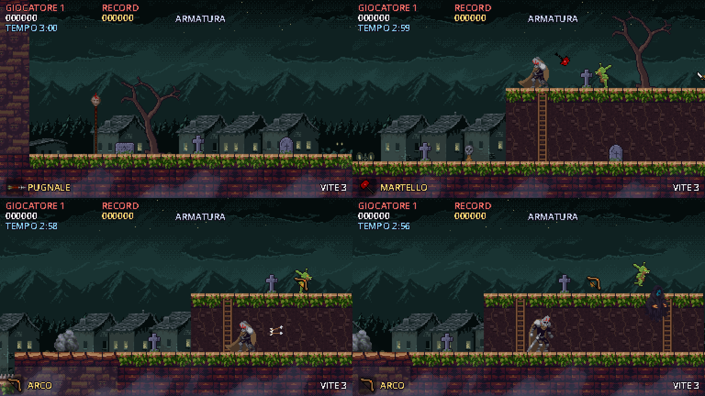

# Goblin Slayer – prototipo (Godot 4)

Platform d'azione alla **Ghosts'n Goblins** con l'ambientazione di **Goblin Slayer** e una
grafica pixel art notturna ispirata a **Monkey Island**. Questo è il primo livello giocabile:
"Il cimitero dei goblin", disegnato sul primo livello di Ghosts'n Goblins (cimitero, colline a due
piani con le scale a pioli, lapidi, alberi morti, spettri in volo).



## Come aprirlo
1. Usa **Godot 4.3 o successivo** (va bene anche la tua 4.7 .NET/"mono": il gioco è in GDScript e non serve installare .NET).
2. Estrai lo zip in una cartella.
3. Apri Godot → **Importa** → seleziona il file `project.godot` nella cartella → **Importa e modifica**.
4. Premi **F5** (o il pulsante ▶ in alto a destra) per giocare.

La prima apertura impiega qualche secondo perché Godot importa le immagini. Con Godot 4.4 o successivo
compare un avviso di conversione del progetto: conferma pure.

## Comandi
| Azione | Tastiera | Gamepad |
|---|---|---|
| Muoversi | A / D oppure frecce | croce / levetta sinistra |
| Salire sulla scala | W oppure freccia su | su |
| Abbassarsi / scendere dalla scala | S oppure freccia giù | giù |
| Saltare | Spazio, K oppure Z | A |
| Lanciare l'arma | J oppure X | X |
| Pausa | Esc oppure P | Start |

## Meccaniche
- **Salto "impegnato"** come in Ghosts'n Goblins: una volta in aria la traiettoria non cambia.
  Per un salto moderno con controllo in aria, seleziona il nodo `Player` e disattiva `Classic Jump`.
- **Armatura**: il primo colpo te la fa volare via in pezzi, il secondo ti uccide. Il **forziere**
  sopra le rovine te la ridà. Le **punte** e i burroni uccidono subito.
- **Goblin**: camminano avanti e indietro e a volte saltano verso di te. Dalle **buche** spuntano
  nuovi goblin quando ti avvicini, come gli zombi del cimitero.
- **Lupi dei goblin**: più resistenti (2 colpi) e ti caricano di corsa quando sei vicino.
- **Spettri**: compaiono dal nulla sopra le colline e volano verso di te ondeggiando (2 colpi).
- **Scale a pioli**: su per salire sulle colline, giù dalla cima per scendere, salto per lasciarsi andare.
  Le cime delle colline si attraversano dal basso; sotto ci si cammina davanti al fianco di terra.
- **Lapidi**: sono solide come nell'originale: fermano le armi e ci si può salire sopra.
- **Armi** (una alla volta, come in Ghosts'n Goblins; l'ultima raccolta sostituisce la precedente e resta
  anche dopo una morte). Alcune sono nel livello, a volte un goblin ucciso ne lascia una:
  | Arma | Come funziona |
  |---|---|
  | Pugnale | quella iniziale: veloce, 3 in volo |
  | Machete | velocissimo e a raffica, ma corto |
  | Alabarda | lenta, lunga gittata, 2 danni |
  | Martello | vola a parabola, 2 danni, trapassa i nemici |
  | Arco | due frecce, una dritta e una verso l'alto |
  | Bastone | palla di fuoco che ondeggia e attraversa nemici e lapidi |
- **Tempo**: 3 minuti per ogni vita; allo zero si muore. Il **record** viene salvato.
- **Cuore**: +1 vita.
- 3 vite, checkpoint a metà livello, punteggio; arrivare alla tana con l'armatura raddoppia il bonus.

## Struttura
```
project.godot          impostazioni (384x216 pixel-perfect, ingrandito 3x)
scenes/                main (livello), player, goblin, dagger, chest, cave_exit, hud...
scripts/               logica in GDScript (player.gd, goblin.gd, level.gd, ...)
levels/level_1.gd      mappa ASCII del livello: modificala per cambiare il percorso
assets/                grafica e suoni usati dal gioco
assets_src/            file originali dei pacchetti grafici (Godot li ignora)
tools/import_packs.py  converte assets_src/ in assets/ (ricolora l'eroe, ritaglia tessere e oggetti)
tools/gen_assets.py    genera goblin, effetti e suoni segnaposto (Python + Pillow)
tools/make_level.py    rigenera la mappa del livello 1
tools/autotest.gd      partita automatica con screenshot (per verifiche)
```

### Modificare il livello
Apri `levels/level_1.gd` (oppure `tools/make_level.py`, che lo rigenera): ogni carattere è una cella 16x16.
`#` terra, `B` pietra, `=` asse, `^` punte, `h` cima di collina, `l` cima di scala, `L` scala,
`T` lapide, `Y` albero morto, `t`/`x` decorazioni, `g` goblin, `w` lupo, `S` buca dei goblin,
`G` spettri, `C` armatura, `H` cuore, `1`–`5` armi, `K` checkpoint, `E` uscita.

### Grafica e crediti
- Eroe, lupo, spettro, palla di fuoco, tileset, sfondo notturno: **Gothicvania Patreon Collection** di Luis Zuno (@ansimuz),
  pubblico dominio (vedi `assets_src/gothicvania/public-license.txt`). L'eroe è ricolorato come
  Goblin Slayer: elmo e armatura d'acciaio sporco, mantello di cuoio, pennacchio rosso; senza
  armatura diventa un uomo in tunica.
- Oggetti e scenografie (armatura, cuore, pugnale, teschi su picche, funghi, rocce, spada nella roccia):
  dai file `00_items.png` e `misc_scenery.png` che hai caricato. Verifica la loro licenza prima di pubblicare.
- Armi da raccogliere: pacchetto **5 RPG weapons** che hai caricato (`assets_src/rpgweapons`).
  Verifica la licenza prima di pubblicare.
- Lapidi, alberi morti, scale, fianchi delle colline e nebbia: disegnati da `tools/import_packs.py`
  con la tavolozza di Gothicvania.
- Goblin, punte, ingresso della tana, effetti e suoni: segnaposto generati da `tools/gen_assets.py`
  (i pacchetti non contengono goblin).

Per cambiare grafica: sostituisci i file in `assets_src/` e lancia `python3 tools/import_packs.py`,
oppure sostituisci direttamente i PNG in `assets/` mantenendo le dimensioni dei fotogrammi
(l'ordine delle animazioni è in `ANIMS` dentro `player.gd` e `goblin.gd`).
